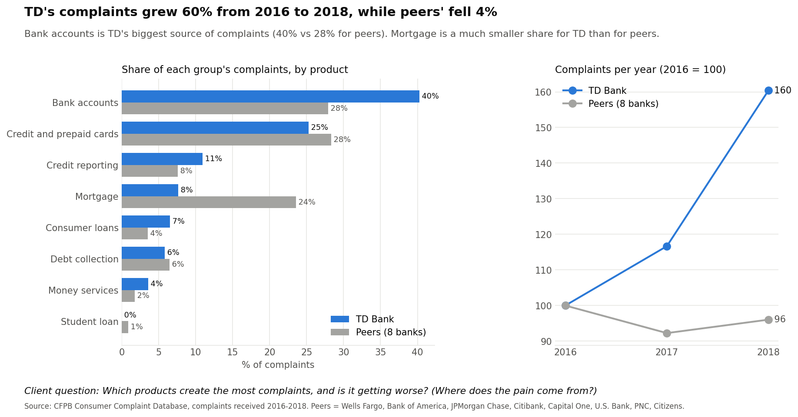
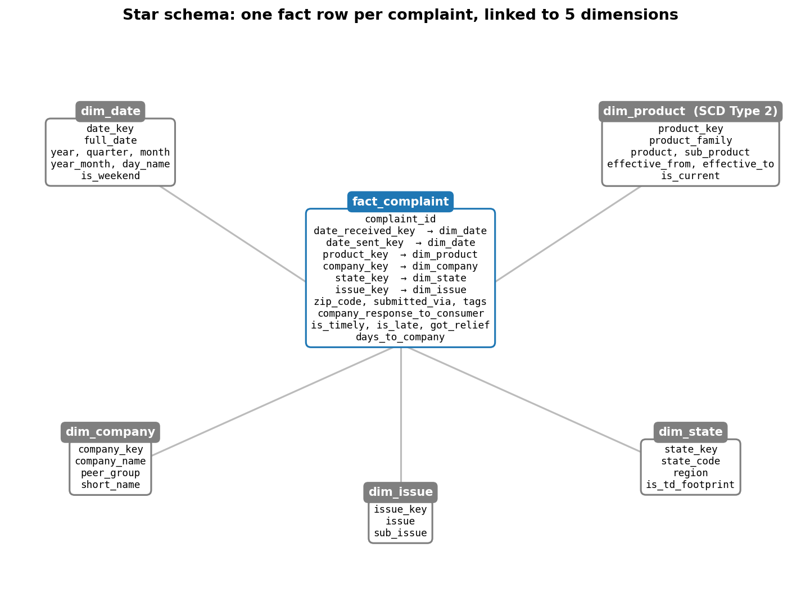

# Bank Complaint Data Warehouse (Project 0)

## The business case

Our client is the US retail arm of a Canadian bank, **TD Bank US**. Every complaint a
customer files about a US bank with the federal regulator, the Consumer Financial
Protection Bureau (CFPB), is published online. Complaints against TD are rising and are
visible to anyone, including customers, journalists and regulators. TD wants to know
**which products, issues and regions drive its complaints, whether it responds as well as
other banks, and what it should fix first**.

We loaded the CFPB's public complaint data for **2016-2018** into a cloud data warehouse
(Google BigQuery) and compared TD with **8 peer banks** using **rates and percentages, not
raw counts**, so that bank size does not distort the picture. We only claim what the data
can show: it has no information on lost customers or costs, and no customer ID.

### The questions we answer

1. **Which products create the most complaints, and is it getting worse?** *(Where does the pain come from?)*
2. **Which states complain most per month?** *(Where should staff go?)*
3. **How often do companies respond late, by product?** *(Where are we slow?)*
4. **How often does TD give relief vs only an explanation, compared with peers?** *(What fixes things?)*
5. **How did complaint patterns shift when the CFPB renamed its product categories on 24 April 2017?** *(Did the change hide or reveal problems?)*

### What we found

| # | Finding |
|---|---------|
| 1 | TD's complaints **grew 60%** from 2016 to 2018 while peers' fell 4%. **Bank accounts** are TD's biggest source (40% of its complaints vs 28% for peers). |
| 2 | **NY, FL and NJ** produce **42%** of TD's complaints, about twice their share for peers (NY alone: about 25 complaints a month). |
| 3 | TD answered late **only once in 4,977 complaints**; peers were late **2.2%** of the time. |
| 4 | TD gives relief in **36%** of complaints vs **23%** for peers, and more often in every product. |
| 5 | Credit-reporting complaints rose for TD **and** peers from early 2017, before and after the rename. It is a real, market-wide rise, not a TD-only problem. |
| Correlation | In busier months TD gives relief less often (**r = -0.64** over 36 months; -0.53 without the January 2018 spike). **This may not be cause and effect**: the product mix changed at the same time, with more credit-reporting complaints, which get relief less often. |

**What to fix first:** TD responds on time and gives relief more often than peers, but its
volume is growing fast, mostly in bank accounts and in NY, FL and NJ. The risk is that
relief rates drop when volume rises.

All charts are in [`charts/`](charts/). Each title states the finding, TD is shown in blue
and the peers in grey, and the client question is printed at the bottom.



---

## How it works

```
complaints.csv (5.3 GB)
   │  ingest/run.py  (Python + pandas: read in chunks, clean, reject, dedupe)
   ▼
BigQuery staging:  complaints · rejects · load_log
   │  scripts/build_dw.py  (runs sql/dw/*.sql)
   ▼
BigQuery dw (star schema):  fact_complaint + 5 dimensions
   │  sql/01-06  (one client question each)
   ▼
scripts/make_charts.py  →  charts/*.png
```

### Star schema



- **fact_complaint**: one row per complaint (691,167 rows), with keys to each dimension and
  the measures `is_timely`, `is_late`, `got_relief` and `days_to_company`.
- **dim_date**, **dim_company** (client / peer / other), **dim_state** (region, TD footprint),
  **dim_issue**.
- **dim_product** is a **Slowly Changing Dimension Type 2**. On 2017-04-24 the CFPB renamed
  and merged its product categories (for example, "Credit reporting" became "Credit
  reporting, credit repair services, or other personal consumer reports"). Each label keeps
  `effective_from`, `effective_to` and `is_current`, and `product_family` links old and new
  labels so a product can be followed across the change. Question 5 uses this history.

### Engineered features

- `days_to_company`: days from the CFPB receiving the complaint to sending it to the company.
- `is_late` and `got_relief`: flags in the fact table.
- `rolling_3m_complaints`: 3-month rolling average of TD's monthly complaints (`sql/06`).

---

## Data

- **Source:** CFPB Consumer Complaint Database,
  <https://www.consumerfinance.gov/data-research/consumer-complaints/> (download the full CSV).
- The file we used has **18,908,088 rows** (2011-2026). We keep complaints **received
  2016-01-01 to 2018-12-31: 691,167 rows**. Rows outside this range are filtered out, not rejected.
- It has 15 columns. The column "Consumer disputed?" is **not** in the current download
  (the CFPB stopped collecting it in April 2017), so we do not use it.
- **Client:** `TD BANK US HOLDING COMPANY` (4,977 complaints).
  **Peers:** Wells Fargo, Bank of America, JPMorgan Chase, Citibank, Capital One, U.S. Bancorp,
  PNC and Citizens (137,926 complaints together). The exact names are in `sql/dw/03_dim_company.sql`.

### Cleansing rules (`ingest/clean.py`)

1. Column names become snake_case (BigQuery does not allow spaces or `?`), e.g. `Timely response?` → `timely_response`.
2. All 15 expected columns must be present, or the job stops with a clear error.
3. Text: trim spaces, collapse repeated spaces, and turn blanks into missing values. Company and product names keep their official upper/lower case.
4. Keep only complaints received 2016-2018.
5. **Reject** a row (saved to `staging.rejects` with a reason), checked **before** any gaps are filled:
   `missing complaint_id`, `invalid date_received`, `sent before received`, `missing company`, `missing product`.
6. Remove duplicates using **Complaint ID only** (also across chunks).
7. Fill gaps: Sub-issue → "Not provided", Company public response → "No public response",
   Tags → "None", State → "Unknown". State codes are upper-cased.
8. Types: both dates become real dates, "Yes"/"No" becomes the boolean `is_timely`. ZIP codes
   stay as text because some are masked (e.g. `811XX`).
9. Add `days_to_company`.

The real 2016-2018 data had **no rejected rows and no duplicates**. To show the rules working,
[`samples/sample_input_complaints.csv`](samples/sample_input_complaints.csv) is a small
**made-up** file with one broken row per reject reason. Its output is in
[`samples/sample_rejects.csv`](samples/sample_rejects.csv).
[`samples/sample_load_log.csv`](samples/sample_load_log.csv) is the real load log from our two runs.

---

## How to run everything from a fresh clone

### 1. Install

Python 3.9 or newer.

```bash
git clone <this-repo-url>
cd ai-team-project
python3 -m venv .venv
source .venv/bin/activate
pip install -r requirements.txt
```

### 2. Credentials (never stored in this repo)

Install the Google Cloud CLI (`brew install --cask google-cloud-sdk` on a Mac, or see
<https://cloud.google.com/sdk/docs/install>), then log in once:

```bash
gcloud auth application-default login
gcloud config set project <your-gcp-project-id>
```

This saves a login on **your own computer** (in `~/.config/gcloud/`), outside the project.
No key files are needed, and `.gitignore` blocks `*.json` and `.env` files as an extra safeguard.

### 3. Settings

Copy [`config.example.yaml`](config.example.yaml) to `config.yaml` and set
`bigquery.project` to your own project ID. Adding another source file is a config change
(one more entry under `sources`), not a code change.

### 4. Data

Download the CFPB CSV (link above) and save it as `data/raw/complaints.csv`.
The `data/` folder is ignored by git.

### 5. Run the pipeline

```bash
python -m ingest.run --dry-run   # optional: clean only, nothing sent to BigQuery
python -m ingest.run             # load staging.complaints, staging.rejects, staging.load_log (~4 min)
python scripts/build_dw.py       # build the star schema in the dw dataset (~30 s)
python scripts/make_charts.py    # run sql/01-06 and save charts/*.png
```

The ingest job is **idempotent**: the first chunk of each run replaces the complaints and
rejects tables (`WRITE_TRUNCATE`) and the rest are appended, so running it twice gives the
same data. The load log gains one row per run, by design. The `dw` build uses
`CREATE OR REPLACE TABLE`, so it can also be re-run safely.

### 6. Run the queries yourself

Open any file in [`sql/`](sql/) and paste it into the BigQuery console with your project
selected. Each file starts with the client question and what the answer means for the client.

### 7. Run the tests

```bash
pytest
```

The tests cover the cleaning and transform functions. **No test connects to BigQuery.**

---

## Project layout

```
config.yaml / config.example.yaml   settings (real / placeholders)
requirements.txt
ingest/        clean.py (cleaning rules), run.py (the ingest job)
tests/         test_clean.py, test_run.py
sql/dw/        01-07: build the star schema
sql/           01-06: one client question each
scripts/       build_dw.py, make_charts.py, make_samples.py, draw_star_schema.py
charts/        chart PNGs
docs/          star_schema.png, PROJECT_GUIDE.md (project rules and decisions)
samples/       sample input, sample rejects, sample clean output, sample load log
data/raw/      the raw CSV (ignored by git)
```

## Limitations

- **Not cause and effect:** the correlation shows that two things move together, not that one causes the other.
- **No customer ID:** we cannot see whether the same customer complained again.
- **No cost or churn data:** we cannot say what complaints cost TD or whether customers left.
- **Pooled peers:** the peer rates are weighted by volume, so the big four banks count the most.
  PNC and Citizens are the closest in size to TD.
- **TD footprint:** the list of states where TD has branches (`sql/dw/04_dim_state.sql`) should be
  checked against td.com.
- **Small counts:** products with fewer than 100 complaints in a group are left out of the rate comparisons.
- **BigQuery sandbox:** tables expire after 60 days, so re-run the pipeline if they are gone.
